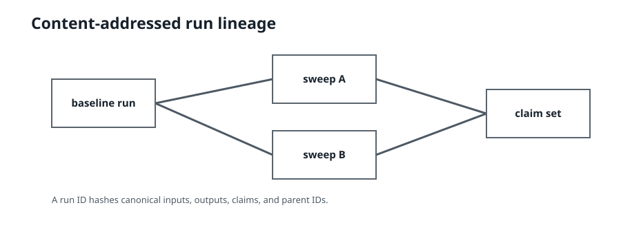

# scientific-run-registry



A small, dependency-free registry that gives a computational run a stable identifier derived
from canonical inputs, outputs, claims, and parent runs. It makes stale or modified records
detectable without imposing a database.

```python
from run_registry import Registry
run=Registry("runs.json").register({"x":1},{"y":2},["C1"])
```

Run `python tools/generate_figure.py` and `python -m unittest discover -s tests -v`. The repository is a reusable primitive,
while [VOLLEY](https://github.com/aaaaaaaaaaaavm/VOLLEY) remains the flagship application.

## Atomicity and concurrency

On a **local POSIX filesystem**, cooperating writers use a stable `runs.json.lock` sidecar
and hold an exclusive advisory `flock` across the full read–modify–write transaction. New
contents are written to a temporary file in the same directory, flushed and fsynced, then
atomically replace the destination. Readers see one complete snapshot. The lock file remains
in place deliberately; do not delete it while the registry is in use.

Tests exercise six independent spawned processes registering 72 distinct runs and one shared
run, plus a failed replacement that must preserve the original file. Content IDs remain
compatible with v1. Invalid non-finite JSON values are rejected before mutation.

This guarantee requires every writer to use this API and the same resolved path. External
editors bypass advisory locks. Windows writes fail explicitly because POSIX locking is
unavailable; network/distributed filesystems and alternate hard-link aliases are unsupported.
Atomic replacement does not promise directory-entry durability after power loss. This is a
local registry, not a database transaction or immutable archive. Parent existence and digest
checks are evaluated against one snapshot by `verify()`.

[Scientific figures and documentation conventions](docs/FIGURE_STANDARD.md) · [Released figure sources](docs/SCIENTIFIC_FIGURES.json)

The overview figures are regenerated with `python tools/generate_figure.py`. Quantitative plots retain their committed model inputs; diagrams describe relationships and do not add validation evidence.
